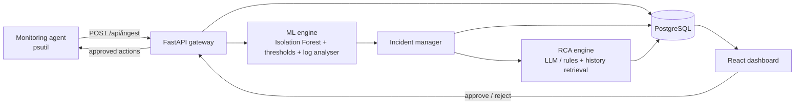
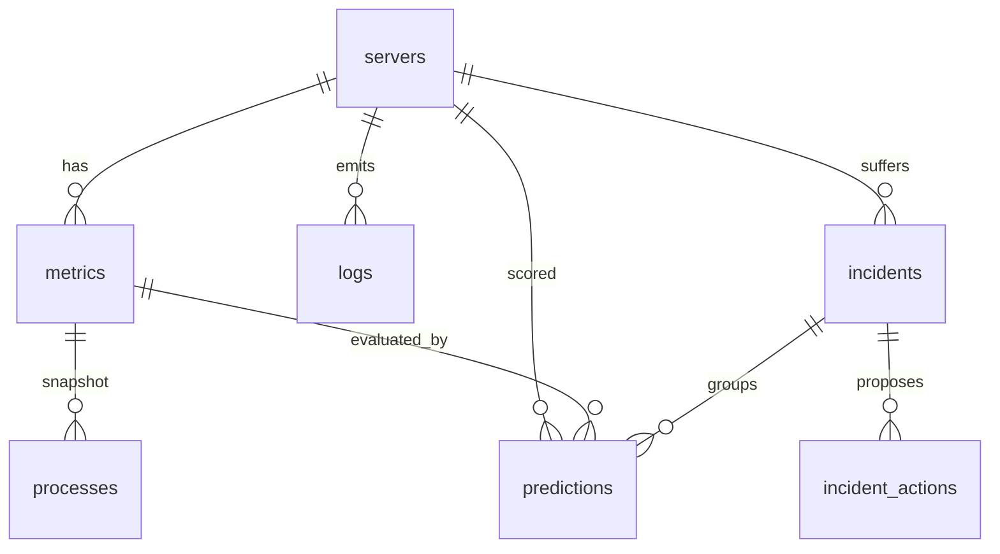

# AIOpsGuard Architecture

## Data flow
1. Agent samples CPU, RAM, disk, process list, new log lines (every 5 s).
2. `POST /api/ingest` stores everything in **one transaction** (server upsert, metric, processes, logs).
3. `ml/detector.py` scores the sample; `ml/log_analyzer.py` scores logs; a prediction row is stored.
4. Anomaly -> `incidents/manager.py` opens (or escalates) the single active incident for that server.
5. Background task runs `incidents/rca.py`: evidence + similar resolved incidents -> LLM or rule engine -> stored RCA and *proposed* actions.
6. Human approves in the dashboard -> agent polls approved actions -> validates PID + name + protection list -> executes -> reports result (audit trail in `incident_actions`).
7. Five consecutive normal predictions auto-resolve the incident.

## ER diagram

## DBMS concepts demonstrated (for viva)
| Concept | Where |
|---|---|
| ER modelling, 3NF | `schema.sql` (processes -> metrics, not servers) |
| Keys and constraints | PK/FK, UNIQUE hostname, CHECK ranges and enums |
| Partial unique index | `uq_active_incident_per_server` (max one active incident per server) |
| Indexes | `(server_id, ts DESC)`, partial index on error logs |
| Triggers | `last_seen` update on metric insert; incident `resolved_at`/`updated_at` lifecycle |
| Views | `v_server_overview` (LATERAL joins), `v_incident_summary` |
| Transactions | `store_telemetry()` is atomic (rollback tested), `open_or_update()` uses `SELECT ... FOR UPDATE` |
| Concurrency | row locking + unique-violation retry on incident creation |
| Stored function | `purge_old_telemetry()` |

## OS concepts demonstrated
Process monitoring and per-process CPU accounting, memory/resource metrics, load average,
process termination (SIGTERM then SIGKILL), protected-process list (safe resource control),
multi-process stress generation (CPU scheduling contention), thread-safe model cache (synchronisation).

## API summary
| Method | Path | Purpose |
|---|---|---|
| POST | /api/ingest | agent telemetry |
| GET | /api/servers, /api/servers/{id}/metrics, /processes, /logs, /predictions | dashboard data |
| GET | /api/incidents, /api/incidents/{id} | incident list / detail |
| POST | /api/incidents/{id}/analyze, /status | re-run RCA, change status |
| POST | /api/actions/{id}/decision | human approve / reject |
| GET/POST | /api/agents/{host}/actions, /api/agents/actions/{id}/result | agent action channel |
